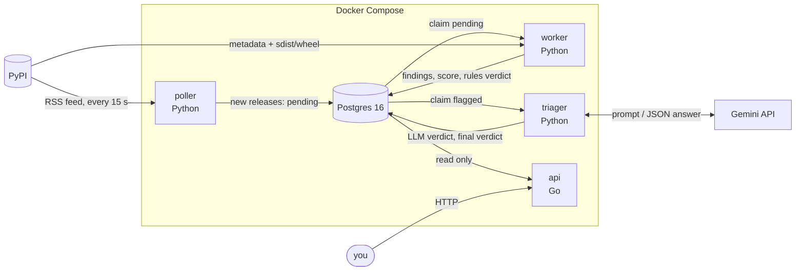
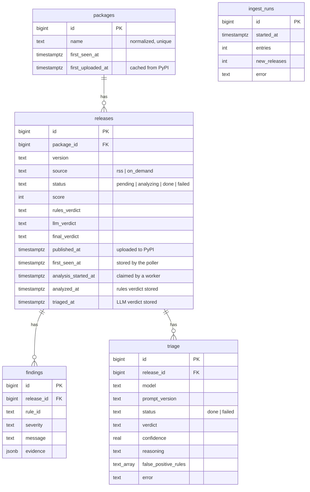

# crotalus

Real-time supply-chain malware detection for PyPI.

crotalus analyzes every new PyPI release within seconds of upload: it reads the
release's metadata and source code (never running it), scores what 12 detection rules
find, and asks an LLM for a second opinion on anything flagged. Verdicts are stored in
Postgres and served by a Go API.

| | Result |
|---|---|
| Live throughput | **~6,000 releases/day**, **20 s** median from upload to verdict |
| Known malicious packages caught (Datadog dataset, held-out) | **83%** (410/495) |
| Hijacked legitimate libraries caught (Datadog dataset) | **89%** (24/27) |
| False positives on popular packages (held-out) | **1.7%** (17/996) |

---

## Why

Installing a Python package runs code written by a stranger. Attackers use that in a
few recurring ways:

- **Typosquatting:** publish `reqeusts` and wait for someone to mistype `requests`.
- **Install-time payloads:** `pip install` of a source distribution runs its
  `setup.py` before anyone has looked at the package.
- **Account or build takeover:** add a few lines to a trusted library's `__init__.py`;
  they run on every `import`, on every machine that upgrades.
- **Hidden code:** `exec(base64.b64decode("..."))`, so the real code never appears in
  the source.

Malicious packages are usually removed within hours, so the window that matters is
right after upload.

---

## Architecture



The services never call each other: **Postgres is the only thing they share**, and it
doubles as the job queue. Each stage picks up rows the previous one left in a given
state:

| Stage | Takes | Does | Leaves |
|---|---|---|---|
| poller (`poller.py`) | PyPI's feed of the latest ~100 uploads, every 15 s | stores releases it hasn't seen | `pending` |
| worker (`worker.py`) | the oldest `pending` release | downloads its sdist and one wheel, runs the rules, scores the findings | `done`, with findings and a rules verdict |
| triager (`triager.py`) | the oldest flagged release this prompt hasn't seen | asks Gemini, combines its answer with the rules' | an LLM verdict and a final verdict |
| api (`api/`) | `done` releases | serves them as JSON | |

So a stage can crash, restart or scale on its own; a slow, rate-limited LLM never
holds up analysis; and everything is replayable, since findings are stored with their
evidence.

**Failures.** The worker claims and analyzes a release in one transaction, so if it
dies, Postgres rolls back and the release is `pending` again. PyPI or Gemini being
down means wait and retry; a release that can't be analyzed is marked `failed` so it
isn't retried forever.

**Archives are hostile.** Nothing is extracted to disk or executed. Files are read
from the archive bytes in memory (a path like `../../.bashrc` is just a dict key),
only `.py`, `.pth` and `pyproject.toml`, with limits on download size (50 MB), entries
(20,000), bytes per file (2 MB) and total bytes (100 MB) against archive bombs.

---

## Detection rules

Each rule is `check(context) -> list[Finding]`; a finding has a severity (`low` to
`critical`), a message and JSON evidence (file, line, snippet). Rules live in
`rules/`, grouped by what they look at:

**`metadata/`: PyPI's information about the release.** Weak alone, but they add up.

| Rule | Detects | Severity |
|---|---|---|
| `typosquat` | name 1-2 edits from a top-5,000 package (names under 8 characters: 1 edit) | high (1) / medium (2) |
| `new_package` | package created within 7 days (1 day) | low / medium |
| `sdist_only` | no wheel, so installing always runs `setup.py` | low |
| `no_project_links` | no homepage or repository | low |
| `missing_metadata` | no summary and no author | low |
| `suspicious_links` | raw IPs, URL shorteners, paste sites, chat invites | medium |
| `late_file_upload` | a file added to a release a day or more after the first | medium |

**`hidden_code/`: code that runs from where a reader wouldn't look.**

| Rule | Detects | Severity |
|---|---|---|
| `hidden_code_exec` | `exec`/`eval` of **decoded** (`base64`, `zlib`, `marshal`...) or **downloaded** data | critical |
| `pth_import_running_code` | a `.pth` file line that Python runs on **every startup** | medium; critical if it calls run-code, decoder, process or network functions |

**`process_and_network/`: programs and network calls, by when they run.**

| Rule | When it runs | One kind (process or network) | Both, or a process run with decoded data |
|---|---|---|---|
| `install_time_code` | `pip install` (the sdist's `setup.py` and the modules it imports) | medium | high / critical |
| `import_time_code` | every `import pkg` | **high** | critical |
| `unimported_script_code` | only when someone runs the script | medium | medium |

Honest `setup.py` files often run build tools, so one kind alone is only medium there.
Honest libraries almost never start programs or make requests just because they were
imported, and a hijacked library has nothing else wrong with it, so at import time it
is high on its own. "Network" means calls that actually connect (`requests.get`,
`urlopen`, `socket.socket`), not settings like `httpx.Timeout(...)`.

---

## Static analysis

The code rules parse source with Python's `ast` module (`rules/helpers/`) and never
run it. Three ideas do most of the work:

**Aliases: what a name really is.** One pass over a file records imports and
assignments, so all of these resolve to `exec` and `base64.b64decode`:

```python
import base64 as b; exec(b.b64decode(x))
e = exec; e(...)
__import__("base64").b64decode(x)
```

**Origins: where a value came from (taint tracking).** Assignments record which
decoder or network calls a value passed through, and copies carry it along:

```python
data = zlib.decompress(base64.b64decode(blob))   # origins: zlib, base64
payload = data
exec(payload)                                     # runs decoded data -> critical
```

**The import graph: what runs when the package is imported.** Within a file, top-level code and
class bodies run on import; function bodies and `if __name__ == "__main__":` don't,
unless the top level calls the function (or starts it as a thread). Across files,
`modules_run_on_import` starts from each package's `__init__.py` and follows its
imports (relative, absolute, `src/` layouts). A module nothing imports, like a
Streamlit app or a launcher script, isn't import-time code; it's
`unimported_script_code`'s job.

**Limits.** Names built at runtime (`getattr(builtins, "ex" + "ec")`) and imports by a
computed name can't be resolved statically. The metadata rules and the LLM are there
to complement that.

---

## Scoring and LLM triage

Each rule counts once, at its worst severity: low 1, medium 3, high 6, critical 10.
Any critical finding, or a score of 10+, is `likely_malicious`; 5-9 is `suspicious`;
below 5 is `clean`. Weak signals add up; one strong signal is enough.

Flagged releases (~2.6% of live traffic) go to Gemini (`gemini-flash-lite-latest`),
which sees the metadata, every finding with its evidence, and the code around each
flagged line, within ~15k tokens. It answers in schema-enforced JSON: a verdict
(`benign` / `suspicious` / `malicious`), confidence, reasoning, and which findings
don't hold up. The prompt asks it to treat findings as claims to check against the
code, and to say `malicious` only when it can point to the line that does harm.

**What the LLM may change** is enforced in code (`scoring.final_verdict`), because it
reads code written by the attacker, who can try to talk it into "benign":

| Rules verdict | LLM says | Final verdict |
|---|---|---|
| `suspicious` | benign, confidence 0.9+ | `clean` |
| `suspicious` | malicious | `likely_malicious` |
| `likely_malicious` | benign, confidence 0.9+ | `suspicious` (lowered, never cleared) |
| anything else | | unchanged |

Everything from the package is also wrapped in `<untrusted>` tags (closing tags inside
it are broken up), and the prompt treats attempts to influence the verdict as a sign
of malice. On live traffic the LLM cleared 54% of flagged releases.

---

## Database

Postgres 16, schema as plain SQL in `migrations/`, each applied in one transaction.



| Table | One row per |
|---|---|
| `packages` | PyPI project (name normalized, first upload cached) |
| `releases` | version: status, score, rules / LLM / final verdict, per-stage timestamps |
| `findings` | thing a rule found, with JSON evidence |
| `triage` | LLM answer, per release, model and prompt version |
| `ingest_runs` | RSS poll, including failed ones |

CHECK constraints keep the stages honest: for example, a release has a score and
verdicts exactly when it's `done`, and a triage row has an answer exactly when it
succeeded.

**Postgres as the job queue.** Workers claim releases with `SELECT ... FOR UPDATE SKIP
LOCKED`: the row stays locked until the transaction ends, and other workers skip it
instead of waiting. Any number of workers can run side by side with no coordination
code, and a crashed worker's release is picked up again automatically.

---

## Containers and API

`docker-compose.yml` runs `db`, `migrate` (applies migrations, then exits), `poller`,
`worker`, `triager` and `api`; the Python services share one image. Start-up waits for
the database to be healthy and the migrations to finish. Postgres and the API are
published on `127.0.0.1` only. The API image is multi-stage, a Go binary on
`distroless/static`: **8.7 MB**, against 228 MB for the Python image.

| Endpoint | Returns |
|---|---|
| `GET /health` | 200 if the database answers, 503 if not |
| `GET /flagged?limit=50` | latest `suspicious` / `likely_malicious` releases |
| `GET /releases/{name}/{version}` | verdicts, findings with evidence, latest triage; 404 if not analyzed |

```json
GET /releases/examplepkg/1.0.0
{
  "name": "examplepkg", "version": "1.0.0", "score": 7,
  "rules_verdict": "suspicious", "llm_verdict": "malicious", "final_verdict": "likely_malicious",
  "findings": [{"rule_id": "install_time_code", "severity": "...", "message": "...", "evidence": {...}}, ...],
  "triage": {"verdict": "malicious", "confidence": ..., "reasoning": "...", ...}
}
```

---

## Evaluation

`eval/` runs the same rules, scoring and (optionally) LLM as the pipeline on labeled
data:

- **Malicious:** [Datadog's malicious-software-packages-dataset](https://github.com/DataDog/malicious-software-packages-dataset),
  real PyPI malware, read from encrypted zips in memory inside a throwaway container.
  `malicious_intent` are packages built to do harm; `compromised_lib` are legitimate
  libraries that shipped a malicious version.
- **Benign:** random samples of the top 5,000 PyPI packages.

| Set | Samples | Result (rules only) |
|---|---|---|
| `malicious_intent` (held-out seed) | 495 | 410 caught (82.8% ± 3.3); a code rule fired on 69% |
| `compromised_lib` | 27 | 24 caught (89%), up from ~30% before `import_time_code` |
| top packages (held-out seed) | 996 | 17 flagged (1.7%) |
| near-misses (score 3-4) + LLM review | 58 malware / 60 benign | 30 caught / 0 flagged |

"Held-out" means sampled with a seed the rules were never tuned on: on the tuned
samples the false-positive rate looked like 0%. The near-miss row is an experiment,
not yet part of the live pipeline: it would raise malware detection to 89%.

```bash
docker compose --profile eval build eval
docker compose run --rm eval eval/malicious.py --kind malicious_intent --limit 500 --seed 1 --out eval/results/malicious.csv
docker compose run --rm eval eval/benign.py --limit 1000 --seed 1 --out eval/results/benign.csv
```

Add `--triage` to include the LLM (uses Gemini quota), and set `GITHUB_TOKEN` in `.env`
to avoid GitHub's rate limit when listing dataset samples.

---

## Running it

Requires Docker.

```bash
git clone https://github.com/zaansaeed/crotalus.git && cd crotalus
cp .env.example .env              # add GEMINI_API_KEY for LLM triage (optional)
docker compose up -d --build
docker compose logs -f worker     # releases being analyzed
curl localhost:8080/flagged
```

The database starts empty: crotalus analyzes releases published from then on.

**Deployment.** The live instance runs the same stack on AWS EC2 (Ubuntu 24.04,
`t3.small`). Its security group allows only SSH, from one IP; Postgres and the API are
reached through an SSH tunnel (`ssh -N -L 9090:127.0.0.1:8080 ubuntu@<host>`). Secrets
live only in `.env` on the instance, never in the repo or the images.

---

## Development

Requires Python 3.12+ and Docker.

```bash
python -m venv .venv && .venv/Scripts/activate   # or: source .venv/bin/activate
pip install -e ".[dev]"
docker compose up -d db                            # tests use a separate crotalus_test database
pytest                                             # 278 tests
ruff check . && ruff format --check . && mypy
cd api && go test ./...
```

To add a rule: write a module with `check(context) -> list[Finding]` in the `rules/`
folder it fits, add it to `RULES` in `rules/__init__.py`, add tests, and run the evals
to see its effect on detection and false positives.

## License

MIT
